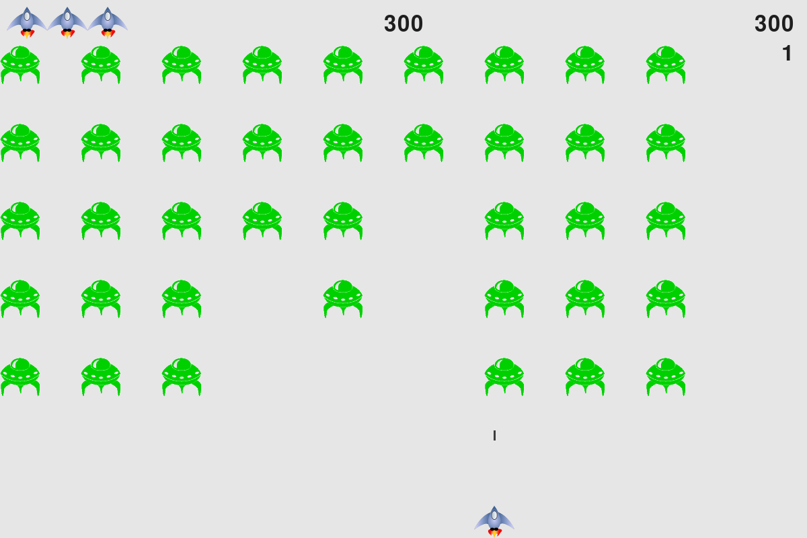
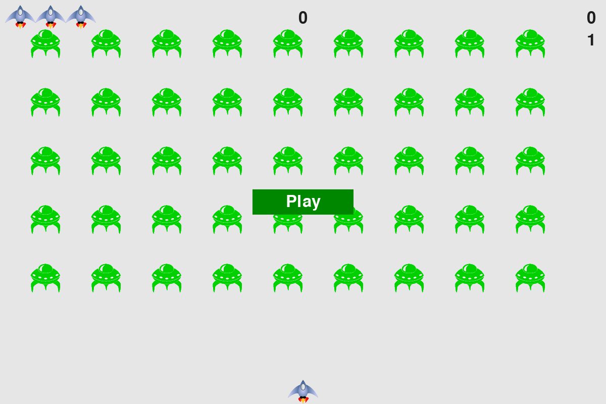

# Alien Invasion

A Python arcade game from **Python Crash Course, Third Edition** by Eric Matthes. Pilot a spaceship, shoot down an alien fleet, and survive increasingly fast waves.



## About the game

This is the completed project from **Chapters 12–14**, built with **Pygame**. The eight Python files and both original bitmap images exactly match the author's official `chapter_14/scoring` snapshot. This repository adds installation instructions and screenshots.

- Move your ship across the bottom of the screen and fire at the fleet.
- Keep up to three bullets on screen at once.
- Clear a fleet to advance a level, increase movement speeds, and earn more points per alien.
- Watch your score, session high score, level, and remaining ships on the scoreboard.
- Click **Play** to start again after a game ends.

## Screenshots

### Start screen



### In action


Both screenshots were captured from this game's own Pygame renderer at its native **1200 × 800** resolution.

## Installation

You need **Python 3.11 or newer**, pip, and a desktop environment that can open a game window. The dependency is **Pygame 2.6.1**.

Clone the repository and open the game folder:

```bash
git clone https://github.com/MinaSaad123/alien-invasion.git
cd alien-invasion
```

Create a virtual environment:

```bash
python -m venv .venv
```

Activate it using the command for your system:

| System | Command |
| --- | --- |
| macOS / Linux | `source .venv/bin/activate` |
| Windows PowerShell | `.venv\Scripts\Activate.ps1` |
| Windows Command Prompt | `.venv\Scripts\activate.bat` |

Install the dependency and start the game:

```bash
python -m pip install -r requirements.txt
python alien_invasion.py
```

If your system uses `python3`, substitute it for `python`. Run the game from the repository folder so its relative image paths resolve correctly.

## Controls

| Action | Control |
| --- | --- |
| Start / restart | Click **Play** |
| Move left | Left arrow |
| Move right | Right arrow |
| Shoot | Spacebar |
| Quit | **Q** or close the window |

## How to play

Click **Play**, then use the arrow keys to line up your shots. Press Spacebar to shoot. The fleet moves sideways, reverses direction at the screen edges, and drops toward your ship.

An alien hitting the ship or reaching the bottom costs a ship. Clear the entire fleet to start the next level. After game over, click **Play** to reset the score, level, and speed for a new run.

The high score is retained between games in the same session. It resets when you close the application, matching the book's base project.

